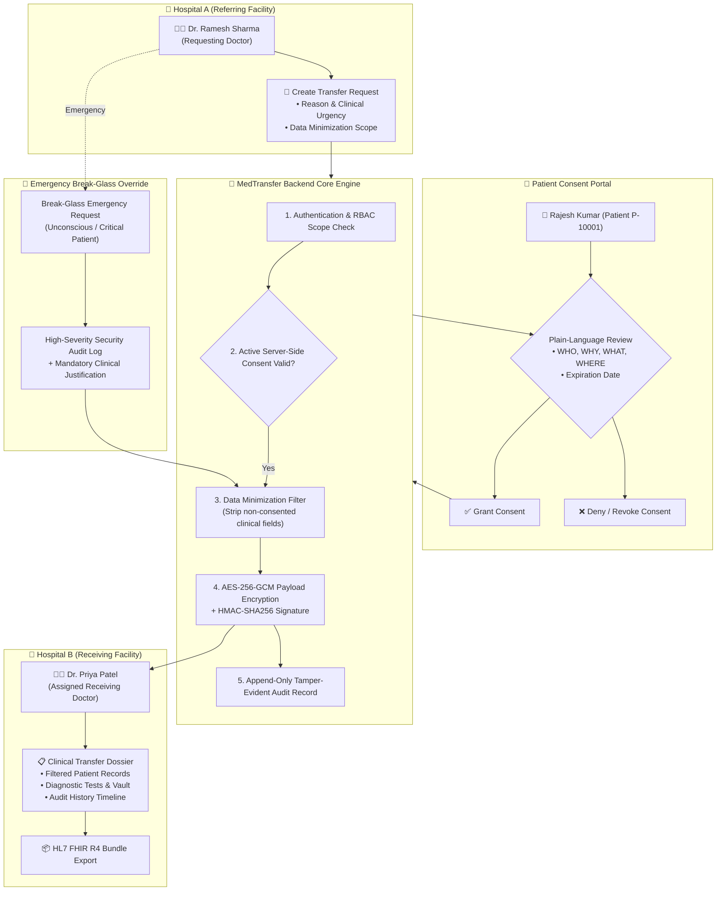

# Secure Consent-Based Inter-Hospital Patient Data Exchange System (MedTransfer)

[](#encryption--cryptographic-packaging)
[](#user-roles--rbac)
[](#data-minimization-engine)
[](#hl7-fhir-r4-interoperability-standard)
[](#immutable-audit-logging-system)

> **ACADEMIC & PROTOTYPE DISCLAIMER**
> *This system is a working academic prototype built for educational and demonstration purposes. It uses synthetic patient data and should not be used with real patient information without completing appropriate security, privacy, compliance, clinical, legal, infrastructure, and interoperability requirements. Do not claim compliance with HIPAA, India's DPDP Act, ABDM, HL7 FHIR, or any other regulation/standard unless the implementation has actually been evaluated against applicable production requirements.*

---

## 1. System Architecture

MedTransfer facilitates the end-to-end clinical transfer workflow:
**Hospital A (Referring Doctor) $\rightarrow$ Patient Consent / Emergency Break-Glass $\rightarrow$ AES-256-GCM Encrypted Transfer $\rightarrow$ Hospital B (Receiving Doctor) $\rightarrow$ Immutable Audit Trail**



---

## 2. Core Security & Privacy Principles

1. **Identity & Authentication**: JSON Web Tokens (JWT) with secure HTTP headers, cryptographic password hashing (`bcrypt`), and token lifecycle management.
2. **Role-Based Access Control (RBAC)**: Strict least-privilege matrix (`DOCTOR`, `PATIENT`, `HOSPITAL_ADMIN`, `SYSTEM_ADMIN`). Administrators cannot view protected health information (PHI) simply because of their administrative status.
3. **Server-Side Consent Enforcement**: Clinical records are never disclosed based on frontend flags. The backend validates consent status (`GRANTED`), timestamp validity (`expires_at`), and purpose before releasing any data.
4. **Data Minimization Engine**: Only categories explicitly authorized by the requesting doctor and approved by the patient are extracted. Unselected categories (e.g., surgical notes, psychiatric reports, financial metadata) are stripped server-side.
5. **Payload Encryption at Rest & In-Transit**: Inter-hospital transfer bundles are encrypted using **AES-256-GCM** with unique initialization vectors (IV) and signed using **HMAC-SHA256** for package integrity and non-repudiation.
6. **Break-Glass Emergency Access**: Legitimate emergency override workflow for critical/unconscious patients requiring mandatory clinical justification, strict time limits (2 hours default), restricted scope, and high-priority audit alerts.
7. **Immutable Audit Logging**: Every transaction (`LOGIN`, `PATIENT_VIEW`, `TRANSFER_CREATED`, `CONSENT_GRANTED`, `CONSENT_REVOKED`, `DATA_ACCESSED`, `DOCUMENT_DOWNLOADED`, `EMERGENCY_ACCESS_GRANTED`, `UNAUTHORIZED_ACCESS_ATTEMPT`) is immutably recorded with actor ID, IP address, user-agent, timestamp, and purpose.

---

## 3. Database Schema

The database is normalized across 12 relational entities:

```text
hospitals (id, name, code, address, contact_email, phone, is_active, created_at)
users (id, email, password, full_name, role, hospital_id, specialization, phone, is_active, created_at)
patients (id, patient_code, full_name, dob, gender, blood_group, phone, email, address, emergency_contact, current_hospital_id, created_at)
visits (id, patient_id, hospital_id, doctor_id, admission_date, discharge_date, status, chief_complaint, diagnosis, notes, created_at)
tests (id, visit_id, patient_id, test_name, test_category, test_date, result_value, reference_range, unit, status, performed_by, notes)
medications (id, patient_id, visit_id, medicine_name, dosage, frequency, route, start_date, end_date, prescribed_by, notes)
patient_allergies (id, patient_id, allergen, reaction_type, severity, identified_date)
documents (id, patient_id, document_type, title, file_url, file_size_kb, mime_type, uploaded_by, hospital_id, created_at)
transfer_requests (id, transfer_code, patient_id, source_hospital_id, destination_hospital_id, requesting_doctor_id, receiving_doctor_id, transfer_reason, clinical_priority, requested_data, consent_status, transfer_status, created_at, updated_at, expires_at)
consents (id, consent_code, patient_id, transfer_id, requesting_hospital_id, receiving_hospital_id, requesting_doctor_id, receiving_doctor_id, purpose, data_categories, status, granted_at, expires_at, revoked_at, consent_version)
emergency_access (id, emergency_code, doctor_id, patient_id, hospital_id, reason, approved_at, expires_at, status, requested_data_scope)
audit_logs (id, user_id, role, action, patient_id, transfer_id, timestamp, ip_address, user_agent, purpose, result, metadata)
notifications (id, user_id, title, message, type, is_read, related_transfer_id, created_at)
```

---

## 4. API Endpoints

### Authentication (`/api/auth`)
* `POST /api/auth/login`: Authenticate user and issue JWT
* `POST /api/auth/logout`: Terminate session and audit logout event
* `GET /api/auth/me`: Retrieve authenticated user profile and hospital affiliation
* `POST /api/auth/register`: Register new user (administrative only)

### Patients & Medical Records (`/api/patients`, `/api/visits`, `/api/tests`)
* `GET /api/patients`: Get scoped patient roster for authorized hospital
* `GET /api/patients/:id`: Retrieve complete patient clinical dossier
* `GET /api/patients/my-record`: Patient self-service clinical summary
* `POST /api/patients`: Register and admit a new patient
* `POST /api/tests`: Order and record a new laboratory/diagnostic test
* `POST /api/tests/check-duplicate`: Duplicate test detection rule engine

### Transfers (`/api/transfers`)
* `POST /api/transfers`: Create transfer request with data minimization categories
* `GET /api/transfers`: List outgoing and incoming transfers with status filters
* `GET /api/transfers/:id`: View transfer metadata and status
* `GET /api/transfers/:id/data`: Access released clinical data (enforces server-side consent & scope)
* `POST /api/transfers/:id/send`: Dispatch encrypted transfer package
* `POST /api/transfers/:id/receive`: Mark incoming transfer received and acknowledged
* `GET /api/transfers/:id/fhir`: Export clinical transfer payload as HL7 FHIR R4 Bundle

### Consent Engine (`/api/consents`)
* `GET /api/consents/my-consents`: Retrieve all consent requests for authenticated patient
* `GET /api/consents/:id`: Plain-language consent detail
* `POST /api/consents/:id/approve`: Patient approves transfer request
* `POST /api/consents/:id/reject`: Patient rejects transfer request
* `POST /api/consents/:id/revoke`: Patient revokes previously granted consent

### Emergency Break-Glass (`/api/emergency-access`)
* `POST /api/emergency-access/request`: Request time-bound emergency break-glass override
* `GET /api/emergency-access/active`: Check active emergency sessions
* `GET /api/emergency-access/logs`: View emergency access audit trail

### Documents & Audit (`/api/documents`, `/api/audit-logs`, `/api/notifications`)
* `GET /api/documents/:id/download`: Secure authorized file download
* `GET /api/audit-logs`: Query immutable audit logs with search and filters
* `GET /api/audit-logs/security-analytics`: Get security telemetry and metrics
* `GET /api/audit-logs/patient-history/:id`: View data sharing history for a specific patient
* `GET /api/notifications`: Get in-app notification feed

---

## 5. Demo Accounts & Role Switcher

The application comes pre-loaded with synthetic demo accounts. Use the **Quick Switcher** bar at the top of the interface or log in manually:

| Role | Name | Hospital / Scope | Email | Password |
| :--- | :--- | :--- | :--- | :--- |
| **DOCTOR (Hospital A)** | Dr. Ramesh Sharma | AIIMS Trauma Center (#1) | `dr.ramesh@aiims.edu.in` | `doctor123` |
| **PATIENT** | Rajesh Kumar (P-10001) | AIIMS Trauma Center | `patient@demo.local` | `patient123` |
| **DOCTOR (Hospital B)** | Dr. Priya Patel | Apollo Hospital (#2) | `dr.priya@apollo.com` | `doctor123` |
| **DOCTOR (Hospital C - Unauthorized)** | Dr. Amit Verma | Fortis Hospital (#3) | `dr.amit@fortis.in` | `doctor123` |
| **HOSPITAL ADMIN** | S. K. Gupta | AIIMS Trauma Center | `admin@aiims.edu.in` | `admin123` |
| **SYSTEM ADMIN** | SecOps Team | Multi-Hospital Network | `sysadmin@medtransfer.demo` | `sysadmin123` |

---

## 6. End-to-End Demonstration Walkthrough

Follow these steps for a complete live demonstration of the system:

```text
Step 1: Log in as Doctor A (Dr. Ramesh Sharma @ AIIMS)
   ├── Select Patient: Rajesh Kumar (P-10001)
   ├── Click "Initiate Transfer"
   ├── Target Hospital: Apollo Multi-Speciality Hospital
   ├── Receiving Doctor: Dr. Priya Patel
   ├── Priority: URGENT | Reason: Specialized cardiothoracic care
   ├── Select Data Categories: Demographics, Medical History, Diagnosis, Allergies, Medications, Lab Reports
   └── Click "Submit Transfer & Request Consent" (Transfer Status: PENDING_CONSENT)

Step 2: Log in as Patient (Rajesh Kumar)
   ├── Open "Consent Center"
   ├── Review Plain-Language Request:
   │   ├── WHO: Dr. Ramesh Sharma (AIIMS) -> Dr. Priya Patel (Apollo)
   │   ├── WHY: Specialized cardiothoracic care
   │   ├── WHAT: 6 Selected Categories (Financial/Admin excluded)
   │   └── EXPIRY: 7 Days
   └── Click "Approve Consent" (Consent Status: GRANTED)

Step 3: Transfer Dispatch
   └── Doctor A dispatches AES-256-GCM encrypted package to Apollo Hospital

Step 4: Log in as Doctor B (Dr. Priya Patel @ Apollo)
   ├── View "Incoming Transfers" -> Open Transfer TR-2026-0001
   ├── Verify Authorization: Server confirms active GRANTED consent
   ├── Access Clinical Dossier: View permitted records, lab reports, and medications
   └── Click "Export FHIR R4 Bundle" (Generates HL7 FHIR compliant JSON structure)

Step 5: Verify Access Control (Negative Test)
   ├── Log in as Unauthorized Doctor C (Dr. Amit Verma @ Fortis)
   └── Attempt to access Transfer TR-2026-0001 -> Blocked with 403 Forbidden & Security Alert logged

Step 6: Emergency Break-Glass Demonstration
   ├── Doctor A encounters an unconscious trauma patient (P-10002)
   ├── Click "Break-Glass Emergency Access"
   ├── Provide clinical justification: "Patient in hypovolemic shock, unconscious"
   └── System grants 2-hour time-limited emergency session and generates high-severity audit record

Step 7: Audit Trail Verification
   ├── Open "Audit Trail" / "Security Dashboard"
   └── Observe complete chronological timeline of logins, consent approvals, data views, and emergency overrides
```

---

## 7. How to Run Locally

### Prerequisites
* **Node.js**: v18.0.0 or higher
* **npm**: v9.0.0 or higher
* *(Optional)* **PostgreSQL**: v14.0 or higher (MedTransfer automatically activates its high-performance in-memory clinical database if PostgreSQL is not running).

### Backend Setup
```bash
cd backend
npm install
npm run dev
# Backend server runs at http://localhost:5000
```

### Frontend Setup
```bash
cd frontend
npm install
npm run dev
# Frontend application runs at http://localhost:5173
```

### Running Automated Test Suite
```bash
cd backend
node tests/test_full_exchange_workflow.js
node tests/test_auth.js
node tests/test_patient_crud.js
```

---

## 8. Security Checklist & Threat Model

- [x] **Zero Plaintext Secrets**: Cryptographic keys loaded exclusively from environment variables.
- [x] **Server-Side Authorization**: No client-side trust; role verification on every API route.
- [x] **Data Minimization Enforcement**: Non-consented clinical attributes stripped server-side.
- [x] **Tamper-Evident HMAC Integrity**: Encrypted payloads signed with SHA-256 hashes.
- [x] **Append-Only Audit Logs**: Immutable transaction logs with user-agent and IP capture.
- [x] **Break-Glass Audit Alarm**: Emergency access flags generate administrative alerts.
- [x] **Input Validation & Sanitization**: Parameterized queries prevent SQL injection and XSS.
